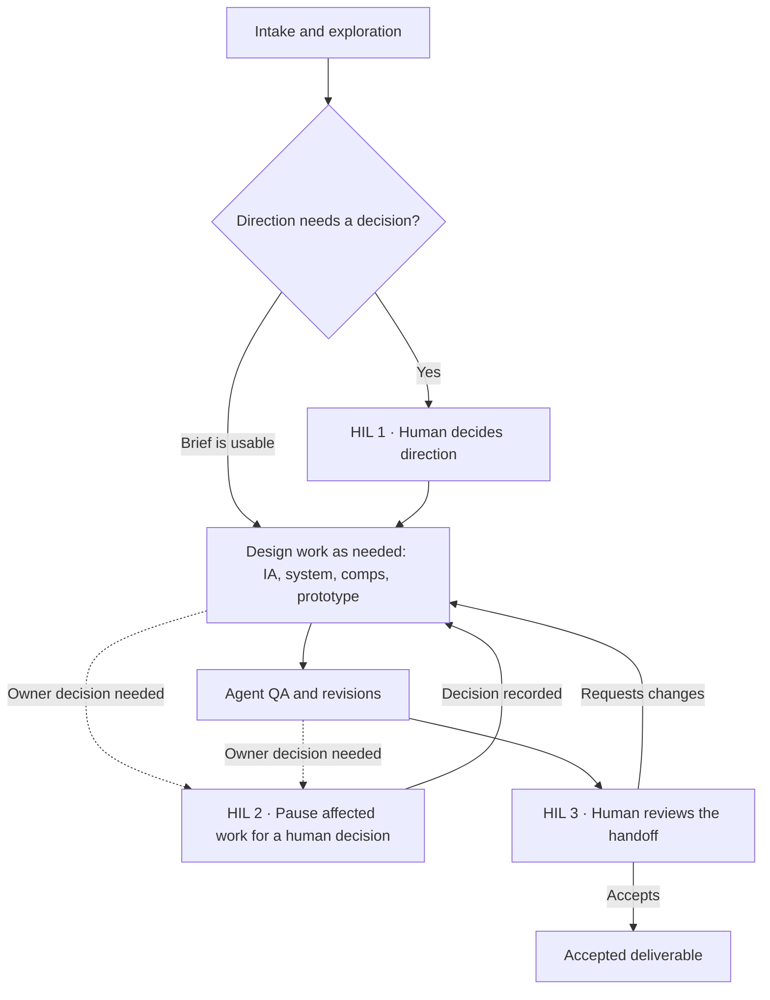

# UX Agent

[Русская версия](README.ru.md)

A project-independent, agent-ready foundation for UX and UI work: research synthesis, information architecture, flows, design systems, components, low- and high-fidelity compositions, interactive prototypes and critique. It runs as an instruction and knowledge base inside a coding agent; it does not provide its own model, tool runtime or autonomous background service.

## Run with a coding agent

Open this repository in Codex or Claude Code and ask the agent to read [AGENTS.md](AGENTS.md) and [the host-agent guide](docs/host-agent.md), then give it a concrete UX task. The host supplies model and tool access; available capabilities vary by environment. See the [synthetic example](examples/task-board/PROJECT.md) for a smoke exercise. The repository contains no prebuilt prototype runtime or automated evaluation runner yet.

Users can work with the harness in Russian. User-facing deliverables default to Russian unless the project or user specifies another language; shared instructions and canon are maintained in English.

## Commands

Use these shortcuts for common outcomes; natural-language requests work too. In Claude Code, invoke `/ux-start`, `/ux-design-system`, `/ux-design` or `/ux-review`. In Codex, invoke the corresponding skills as `$ux-start`, `$ux-design-system`, `$ux-design` or `$ux-review`, or select them through the skill UI. Start a new host session after adding the skills if they are not discovered. The shortcuts use the same project instructions and can be used individually.

- **Start** — structure the brief and identify assumptions and research gaps.
- **Design system** — map source systems, tokens and components into project guidance.
- **Design** — create a flow, wireframe, comp or prototype at the requested fidelity.
- **Review** — assess an existing artifact and report evidence and limitations.

Run the [synthetic evaluations](evals/README.md) to assess the commands on a task-board project. These are manual behavioral evaluations, not a pre-run guarantee of quality.

## Start a project

1. Copy [PROJECT.md](templates/PROJECT.md) into `projects/<slug>/PROJECT.md` and fill in what is known. Label assumptions and research gaps.
2. Give your coding agent a task and point it to [AGENTS.md](AGENTS.md), the project file and any source materials. For an existing system, follow [design system intake](docs/design-systems.md).
3. Select an artifact and fidelity in [workflow](docs/workflow.md). Produce the requested artifact and a short review record, with evidence, open questions and validation status.
4. Review against [canon](canon/README.md) and the relevant source standards. Test interactive work in its actual environment.

Each project owns its own design system and artifacts; no company palette or component library is global. `projects/` intentionally contains no client data.

We recommend interviewing a designer familiar with the project. The agent can start immediately and incorporate the findings as additional project rules when they become available. See [designer interview and project rules](docs/workflow.md#designer-interview).

## Default workflow and human review

The agent selects the steps the task needs. Human review has three points.

1. **HIL 1 — Direction.** After intake and exploration, pause if a missing decision about goals, audience, or scope would materially change the work. With a usable brief, proceed and record reasonable assumptions.
2. **HIL 2 — Material decision.** During design or review, pause the affected work if the owner must resolve a trade-off, such as a conflict between design-system sources or a change in scope. Bring options and a recommendation. Continue work that can proceed independently.
3. **HIL 3 — Acceptance.** After the agent's own QA, hand over the artifact and review evidence. The owner accepts it or requests changes. If the request ends at a draft or report, handing it over completes the task. Record acceptance only when the person gives it.

The agent fixes issues within scope before handoff and marks checks it could not perform. See [workflow and artifact contracts](docs/workflow.md#human-review-and-pause-points).

## Contents

- [Agent instructions](AGENTS.md) — working rules and boundaries.
- [Host-agent guide](docs/host-agent.md) — setup, routing and a smoke exercise.
- [Workflow and artifact contracts](docs/workflow.md) — intake through critique and handoff.
- [Design systems](docs/design-systems.md) — source mapping, DESIGN.md and Figma.
- [Reference preparation](docs/host-agent.md#prepare-references) — select official guidance and keep working copies outside the repository.
- [Canon](canon/README.md) — design principles, rules and practical checks.
- [Project template](templates/PROJECT.md) and [review template](templates/REVIEW.md).

The canon includes [practical design and review checks](canon/README.md#practical-checks). Elvin Rakhmankulov’s [designer interview guide](docs/designer-interview-guide.md) helps translate interview findings into project rules.

## Methodology sources

The design rules and practical checks draw on the sources below. The repository contains extracted, attributed guidance and rules; it does not distribute the original books or source documents. The summaries are interpretations, so consult the originals for their full context and the current language of standards.

- Jakob Nielsen, [10 Usability Heuristics for User Interface Design](https://www.nngroup.com/articles/ten-usability-heuristics/).
- W3C, [Web Content Accessibility Guidelines (WCAG) 2.2](https://www.w3.org/TR/WCAG22/).
- Brad Frost, [*Atomic Design*](https://atomicdesign.bradfrost.com/), 2016.
- Louis Rosenfeld, Peter Morville and Jorge Arango, *Information Architecture: For the Web and Beyond*, 4th edition, 2015.
- Adam Wathan and Steve Schoger, *Refactoring UI*, 2018.
- Luke Wroblewski, *Web Form Design: Filling in the Blanks*, 2008.
- ISO, [ISO 9241-210: Human-centred design for interactive systems](https://www.iso.org/standard/77520.html).
- Google Labs, [DESIGN.md format specification](https://github.com/google-labs-code/design.md/blob/main/docs/spec.md).

### Additional books analyzed

The following sources inform the linked rule collections. Page and chapter references, practical interpretations and limitations appear in the relevant collection.

- Bill Buxton, *Sketching User Experiences* (2007), and Carolyn Snyder, *Paper Prototyping* (2003; one section consulted in a copy flagged as a possible excerpt) — [prototyping](canon/prototyping.md).
- Erika Hall, *Just Enough Research* (2024 edition); Steve Portigal, *Interviewing Users* (2nd ed., 2023); Indi Young, *Mental Models* (2008); Caroline Jarrett, *Surveys That Work* (2021); Tom Tullis and Bill Albert, *Measuring the User Experience* (2nd ed., 2013); Jeff Sauro and James R. Lewis, *Quantifying the User Experience* (2nd ed., 2016) — [research](canon/research.md).
- Don Norman, *The Design of Everyday Things* (revised edition, 2013); Jenifer Tidwell, *Designing Interfaces* (2nd ed., 2011); Steve Krug, *Don't Make Me Think, Revisited* (3rd ed., 2014) and *Rocket Surgery Made Easy* (2010); Sarah Richards, *Content Design* (2017); Susan Weinschenk, *100 Things Every Designer Needs to Know About People* (2nd ed., 2020) — [interaction and content](canon/interaction-content.md).
- Ellen Lupton, *Thinking with Type* (3rd ed., 2024); Josef Müller-Brockmann, *Grid Systems in Graphic Design* (Niggli edition; year unverified); Josef Albers, *Interaction of Color* (4th ed., 2013); Alla Kholmatova, *Design Systems* (2017); Dan Mall, *Design That Scales* (2023); Kat Holmes, *Mismatch* (2018) — [visual design and systems](canon/visual-systems.md).
- Abby Covert, *How to Make Sense of Any Mess* (2014) — [information architecture](canon/information-architecture.md).
- Alan Cooper, Robert Reimann, David Cronin and Christopher Noessel, *About Face: The Essentials of Interaction Design* (4th ed., 2014) — [goal-directed interaction design](canon/interaction-content.md#goal-directed-interaction-design).
- Robert Bringhurst, *The Elements of Typographic Style* (3rd ed., version 3.0, 2004), and Jan Tschichold, *The Form of the Book* (English ed., 1991) — [typography](canon/visual-systems.md#typography).

Additional recommended reading is tracked separately in the library acquisition queue; a recommendation does not imply it has already been analyzed or incorporated into this methodology. As new sources are analyzed, add them here and link extracted guidance to its source.

## License

The [MIT License](LICENSE) covers the project’s original material, including the designer interview guide and the project’s own wording in the canon. Third-party sources remain subject to their own terms. Copyright © 2026 Elvin Rakhmankulov. See [source provenance](docs/source-provenance.md).
