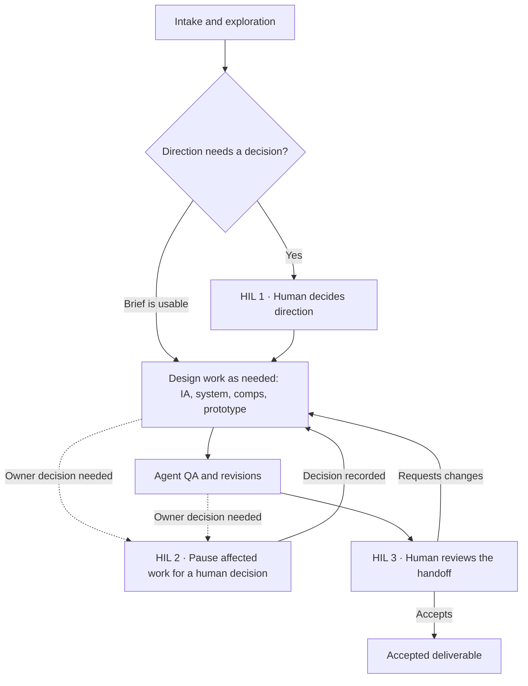

# UX Agent

[Русская версия](README.ru.md)

A project-independent, agent-ready foundation for UX and UI work: research synthesis, information architecture, flows, design systems, components, low- and high-fidelity compositions, interactive prototypes and critique. It runs as an instruction and knowledge base inside a coding agent; it does not provide its own model, tool runtime or autonomous background service.

## Run with a coding agent

Open this repository in Codex or Claude Code and ask the agent to read [AGENTS.md](AGENTS.md) and [the host-agent guide](docs/host-agent.md), then give it a concrete UX task. The host supplies model and tool access; available capabilities vary by environment. See the [synthetic example](examples/task-board/PROJECT.md) and the [sample outputs](examples/task-board/output/README.md) to see what the commands produce. Setup details are in the host-agent guide.

Users can work with the harness in Russian. User-facing deliverables default to Russian unless the project or user specifies another language; shared instructions and canon are maintained in English.

## Commands

Use these shortcuts for common outcomes; natural-language requests work too. In Claude Code, invoke `/ux-<name>`; in Codex, use `$ux-<name>` or select the skill in the host UI. The [host-agent guide](docs/host-agent.md#commands) covers discovery. The shortcuts use the same project instructions and can be used individually.

- **Start** — structure the brief and identify assumptions and research gaps.
- **Design system** — map source systems, tokens and components into project guidance.
- **Design** — create a flow, wireframe, comp or prototype at the requested fidelity.
- **Review** — assess an existing artifact and report evidence and limitations.
- **Research** — plan a study, write a discussion or test guide, or synthesize supplied research.
- **Interview** — turn designer interview notes or a transcript into project rules.

Run the [synthetic evaluations](evals/README.md) to assess the commands and record results in the [results log](evals/results/README.md). The evaluations are judged by a person, with a script for the deterministic checks; they are not a guarantee of quality.

## Start a project

1. Copy [PROJECT.md](templates/PROJECT.md) into `projects/<slug>/PROJECT.md` and fill in what is known. Label assumptions and research gaps.
2. Give your coding agent a task and point it to [AGENTS.md](AGENTS.md), the project file and any source materials. For an existing system, follow [design system intake](docs/design-systems.md).
3. Select an artifact and fidelity in [workflow](docs/workflow.md). Produce the requested artifact and a short review record, with evidence, open questions and validation status.
4. Review against [canon](canon/README.md) and the relevant source standards. Test interactive work in its actual environment.

Each project owns its own design system and artifacts; no company palette or component library is global. `projects/` intentionally contains no client data.

We recommend interviewing a designer familiar with the project. The agent can start immediately and incorporate the findings as additional project rules when they become available. See [designer interview and project rules](docs/workflow.md#designer-interview).

## Default workflow and human review

The agent selects the steps the task needs. Human review has three points.

1. **HIL 1 — Direction.** After intake and exploration, pause if a missing decision about goals, audience, or scope would materially change the work. With a usable brief, proceed and record reasonable assumptions.
2. **HIL 2 — Material decision.** During design or review, pause the affected work if the owner must resolve a trade-off, such as a conflict between design-system sources or a change in scope. Bring options and a recommendation. Continue work that can proceed independently.
3. **HIL 3 — Acceptance.** After the agent's own QA, hand over the artifact and review evidence. The owner accepts it or requests changes. If the request ends at a draft or report, handing it over completes the task. Record acceptance only when the person gives it.

The agent fixes issues within scope before handoff and marks checks it could not perform. See [workflow and artifact contracts](docs/workflow.md#human-review-and-pause-points).

## Contents

- [Agent instructions](AGENTS.md) — working rules and boundaries.
- [Host-agent guide](docs/host-agent.md) — setup, routing and a smoke exercise.
- [Workflow and artifact contracts](docs/workflow.md) — intake through critique and handoff.
- [Design systems](docs/design-systems.md) — source mapping, DESIGN.md and Figma.
- [Reference preparation](docs/host-agent.md#prepare-references) — select official guidance and keep working copies outside the repository.
- [Canon](canon/README.md) — design principles, rules and practical checks.
- [Templates](templates/) — project brief, review, design artifact, prototype specification, source mapping and designer rules.
- [Methodology sources](docs/sources.md) and [contributing](CONTRIBUTING.md).

The canon includes [practical design and review checks](canon/README.md#practical-checks). Elvin Rakhmankulov’s [designer interview guide](docs/designer-interview-guide.md) helps translate interview findings into project rules.

## Methodology sources

The canon draws on standards, foundation articles and practitioner books, listed with the rule collections they inform in [methodology sources](docs/sources.md). The repository contains independently written, attributed rules; it does not distribute the original books or source documents. [Contributing](CONTRIBUTING.md) explains how to add a source or rule.

## License

The [MIT License](LICENSE) covers the project’s original material, including the designer interview guide and the project’s own wording in the canon. Third-party sources remain subject to their own terms. Copyright © 2026 Elvin Rakhmankulov. See [source provenance](docs/source-provenance.md).
