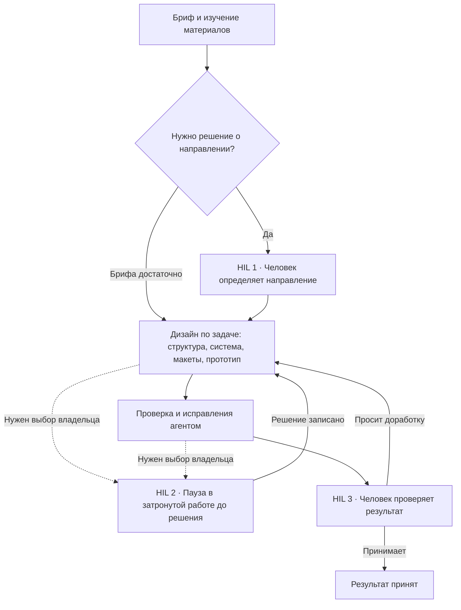

# UX Agent

[English version](README.md)

UX Agent помогает выполнять UX/UI-задачи в Codex или Claude Code. Он опирается на общие правила и источники и учитывает контекст каждого проекта. С его помощью можно систематизировать результаты исследований, проектировать информационную архитектуру и пользовательские сценарии, создавать дизайн-системы, компоненты, вайрфреймы, детальные макеты и интерактивные прототипы, а также проводить ревью интерфейсов.

## Запуск

Открой репозиторий в Codex или Claude Code. Попроси агента прочитать [AGENTS.md](AGENTS.md) и [руководство по запуску](docs/host-agent.md), затем дай ему конкретную UX-задачу. Модель и инструменты предоставляет среда запуска, поэтому доступные возможности зависят от её настроек. Для пробного запуска есть [вымышленный проект](examples/task-board/PROJECT.md), а в [примерах результатов](examples/task-board/output/README.md) видно, что выдают команды.

Агент по умолчанию общается и готовит материалы для пользователя на русском. В запросе или брифе можно указать другой язык. Общие инструкции и свод правил проекта ведутся на английском.

## Команды

Можно использовать команду или просто описать задачу своими словами.

| Задача | Claude Code | Codex |
| --- | --- | --- |
| Составить бриф, зафиксировать допущения и пробелы в исследованиях | `/ux-start` | `$ux-start` |
| Создать или обновить дизайн-систему по исходным материалам | `/ux-design-system` | `$ux-design-system` |
| Создать сценарий, вайрфрейм, макет или прототип | `/ux-design` | `$ux-design` |
| Провести ревью и описать находки, доказательства и ограничения | `/ux-review` | `$ux-review` |
| Спланировать исследование, составить гайд или синтезировать данные | `/ux-research` | `$ux-research` |
| Превратить заметки или транскрипт интервью с дизайнером в правила проекта | `/ux-interview` | `$ux-interview` |

В Codex навык также можно выбрать в интерфейсе. Если после добавления команды она не появилась, начни новую сессию. Команды можно запускать по отдельности. Для команд есть [проверочные задания и критерии оценки](evals/README.md) на примере доски задач, а результаты прогонов записываются в [журнал](evals/results/README.md).

## Как начать проект

1. Скопируй [шаблон PROJECT.md](templates/PROJECT.md) в `projects/<slug>/PROJECT.md`. Заполни известные данные и отметь допущения и пробелы.
2. Опиши задачу и укажи путь к брифу и исходным материалам. Для переноса существующей системы используй [руководство по дизайн-системам](docs/design-systems.md).
3. Укажи, какой результат нужен и с какой детализацией. Попроси приложить краткий отчёт с результатами проверок, открытыми вопросами и ограничениями. Форматы описаны в [рабочем процессе](docs/workflow.md).
4. Проверь результат по [своду правил](canon/README.md) и применимым стандартам. Интерактивные материалы проверь в среде, где ими будут пользоваться.

У каждого проекта свои артефакты и дизайн-система. Папка `projects/` исключена из Git и подходит для локальных материалов проекта.

По возможности проведи интервью с дизайнером, который знаком с проектом. Агент может начать работу сразу, а когда появятся результаты, сформулирует по ним дополнительные правила проекта и будет применять их в дизайне и ревью. [Интервью и правила проекта](docs/workflow.md#designer-interview)

## Рабочий процесс и ревью человеком

Агент выбирает этапы под задачу. В процессе есть три точки участия человека (HIL).

1. **HIL 1 — Направление.** После брифа и изучения материалов агент ждёт решения, если открытый вопрос о цели, аудитории или границах существенно меняет работу. Если брифа достаточно, он продолжает и записывает допущения.
2. **HIL 2 — Существенное решение.** Во время дизайна или ревью агент приостанавливает ту часть работы, где нужен выбор владельца проекта. Например, если источники дизайн-системы противоречат друг другу или меняется объём задачи. Он показывает варианты и рекомендует один из них. Остальная работа может продолжаться.
3. **HIL 3 — Приёмка.** После собственной проверки агент передаёт материалы и результаты проверки. Человек принимает результат или просит доработку. Если задача состояла в подготовке черновика или отчёта, она завершается передачей. Приёмка фиксируется только после решения человека.

Агент исправляет найденные проблемы в рамках задачи до передачи результата и отмечает проверки, которые не удалось провести. Подробнее в [описании точек ревью и остановки](docs/workflow.md#human-review-and-pause-points).

## Документация

- [Инструкции агента](AGENTS.md) — правила работы.
- [Руководство по запуску](docs/host-agent.md) — настройка, выбор процесса и пробный запуск.
- [Рабочий процесс](docs/workflow.md) — от брифа до ревью и передачи результата.
- [Дизайн-системы](docs/design-systems.md) — сопоставление источников, DESIGN.md и Figma.
- [Подготовка справочников](docs/host-agent.md#prepare-references) — как подобрать официальные рекомендации под задачу и сохранить рабочие копии вне репозитория.
- [Свод правил](canon/README.md) и [разбор конфликтов](canon/rule-conflicts.md) — принципы, происхождение и выбор применимых рекомендаций.
- [Шаблоны](templates/) — бриф, ревью, сценарий и вайрфреймы, спецификация прототипа, сопоставление источников и правила дизайнера.
- [Источники методологии](docs/sources.md) и [правила участия](CONTRIBUTING.md).

В каноне собраны [практические проверки для дизайна и ревью](canon/README.md#practical-checks). [Гайд Элвина Рахманкулова по интервью с дизайнером](docs/designer-interview-guide.md) помогает сформулировать правила проекта по итогам разговора.

## Источники методологии

Канон опирается на стандарты, базовые статьи и книги практиков. Полный список с привязкой к разделам правил ведётся в одном месте — [docs/sources.md](docs/sources.md). В репозитории только самостоятельно сформулированные правила со ссылками на источники; оригиналы книг и документов не распространяются. Как добавить источник или правило, описано в [CONTRIBUTING.md](CONTRIBUTING.md).

## Лицензия

[Лицензия MIT](LICENSE) распространяется на авторские материалы проекта, включая гайд по интервью с дизайнером и формулировки проекта в каноне. У сторонних источников действуют собственные условия. © 2026 Elvin Rakhmankulov. Подробнее в [заметках о происхождении материалов](docs/source-provenance.md).
